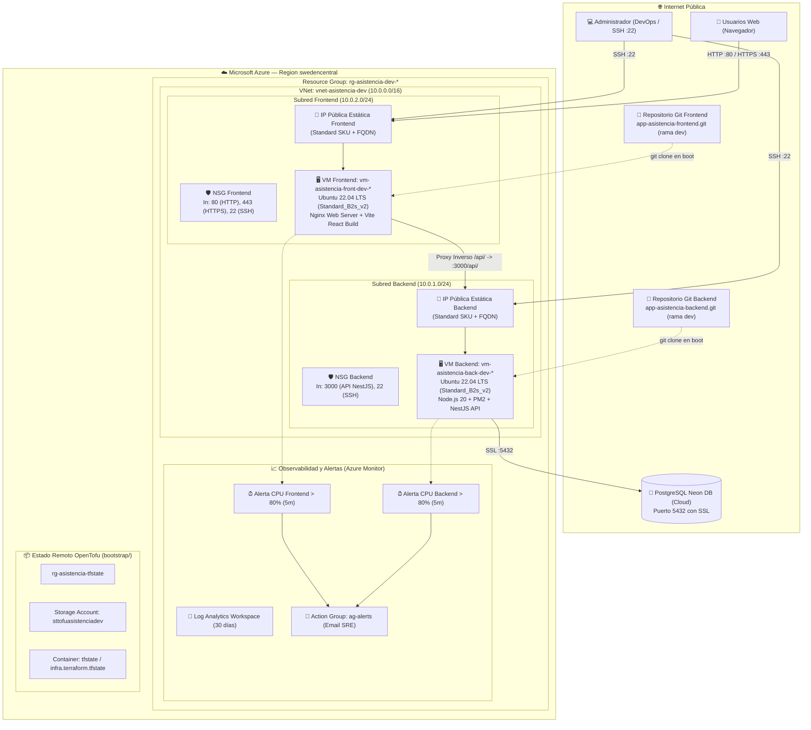
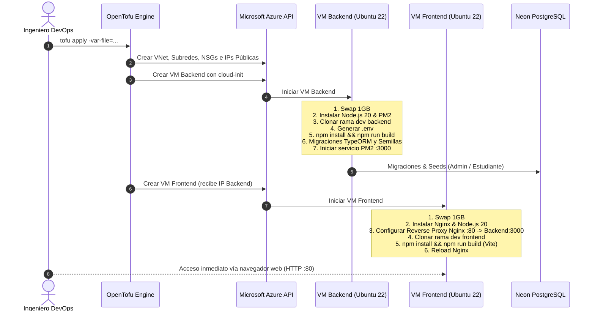

# Guía Visual de Arquitectura — Sistema de Asistencia (Azure con OpenTofu)

Este documento detalla la arquitectura de infraestructura como código (IaC) desplegada en **Microsoft Azure** mediante **OpenTofu**, ilustrando la topología de red, seguridad perimetral, interacción entre Backend y Frontend, y el flujo de despliegue automatizado.

---

## 1. Diagrama General de Arquitectura en Azure

---

## 2. Matriz de Módulos (Alta Cohesión / Bajo Acoplamiento)

Cada archivo en `plantillas/` agrupa exclusivamente los recursos de un dominio técnico específico:

| Archivo de Plantilla | Responsabilidad Única | Recursos Gestionados |
|---|---|---|
| [`main.tf`](file:///d:/soe/modulos/DCID-V1E1%20-%2002%20I%20INFRAESTRUCTURA%20COMO%20C%C3%93DIGO%20%28IAC%29/apps/app4/IAC/azure/OpenTofu/hardware/plantillas/main.tf) | Orquestación raíz y Resource Group | `azurerm_resource_group.rg`, `random_string.suffix`, tags globales |
| [`red.tf`](file:///d:/soe/modulos/DCID-V1E1%20-%2002%20I%20INFRAESTRUCTURA%20COMO%20C%C3%93DIGO%20%28IAC%29/apps/app4/IAC/azure/OpenTofu/hardware/plantillas/red.tf) | Topología y conectividad de red | `azurerm_virtual_network`, subredes backend/frontend, IPs públicas estáticas y NICs |
| [`seguridad.tf`](file:///d:/soe/modulos/DCID-V1E1%20-%2002%20I%20INFRAESTRUCTURA%20COMO%20C%C3%93DIGO%20%28IAC%29/apps/app4/IAC/azure/OpenTofu/hardware/plantillas/seguridad.tf) | Perímetro de firewall y secretos | `azurerm_network_security_group` (backend y frontend), asociaciones NIC-NSG, `jwt_secret` |
| [`backend.tf`](file:///d:/soe/modulos/DCID-V1E1%20-%2002%20I%20INFRAESTRUCTURA%20COMO%20C%C3%93DIGO%20%28IAC%29/apps/app4/IAC/azure/OpenTofu/hardware/plantillas/backend.tf) | Servidor de aplicaciones de negocio | `azurerm_linux_virtual_machine.backend_vm`, disco OS 30GB, cloud-init (Node 20, NestJS, PM2) |
| [`frontend.tf`](file:///d:/soe/modulos/DCID-V1E1%20-%2002%20I%20INFRAESTRUCTURA%20COMO%20C%C3%93DIGO%20%28IAC%29/apps/app4/IAC/azure/OpenTofu/hardware/plantillas/frontend.tf) | Servidor web de presentación | `azurerm_linux_virtual_machine.frontend_vm`, disco OS 30GB, cloud-init (Nginx, React/Vite build) |
| [`monitoreo.tf`](file:///d:/soe/modulos/DCID-V1E1%20-%2002%20I%20INFRAESTRUCTURA%20COMO%20C%C3%93DIGO%20%28IAC%29/apps/app4/IAC/azure/OpenTofu/hardware/plantillas/monitoreo.tf) | Salud operativa y alertas | `azurerm_log_analytics_workspace`, `azurerm_monitor_action_group`, alertas métricas CPU > 80% |

---

## 3. Flujo de Arranque Automatizado con Cloud-Init

